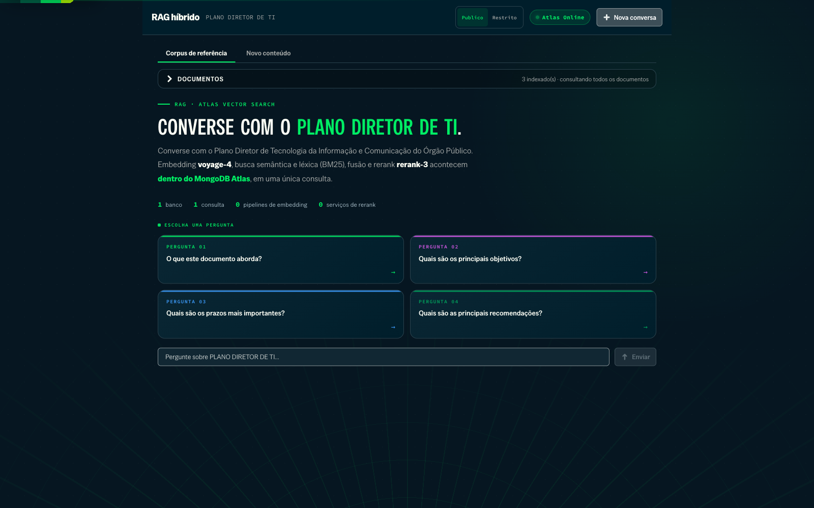
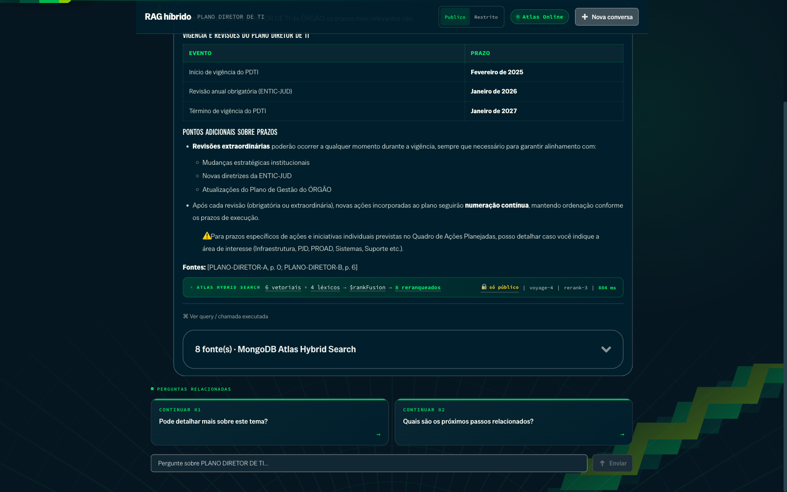
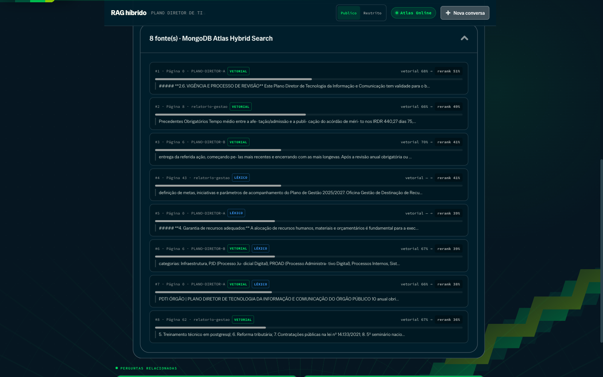
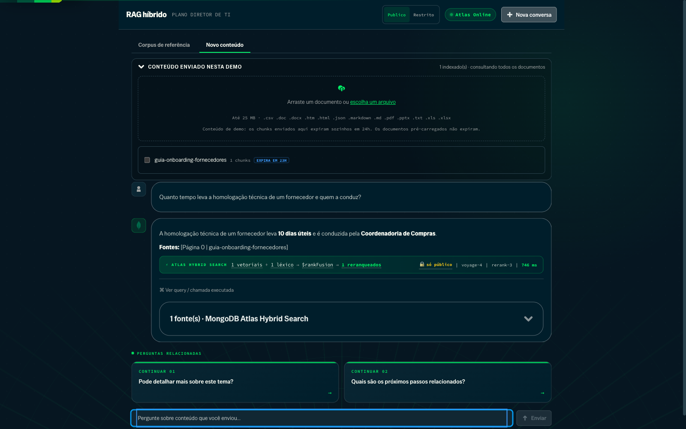
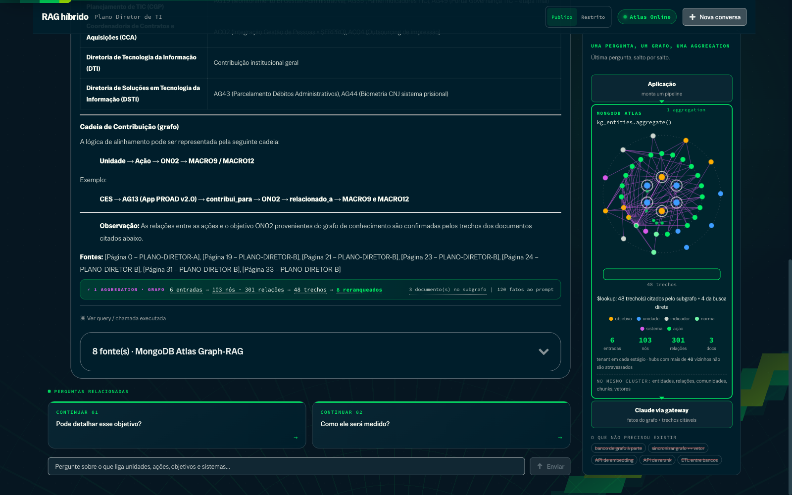
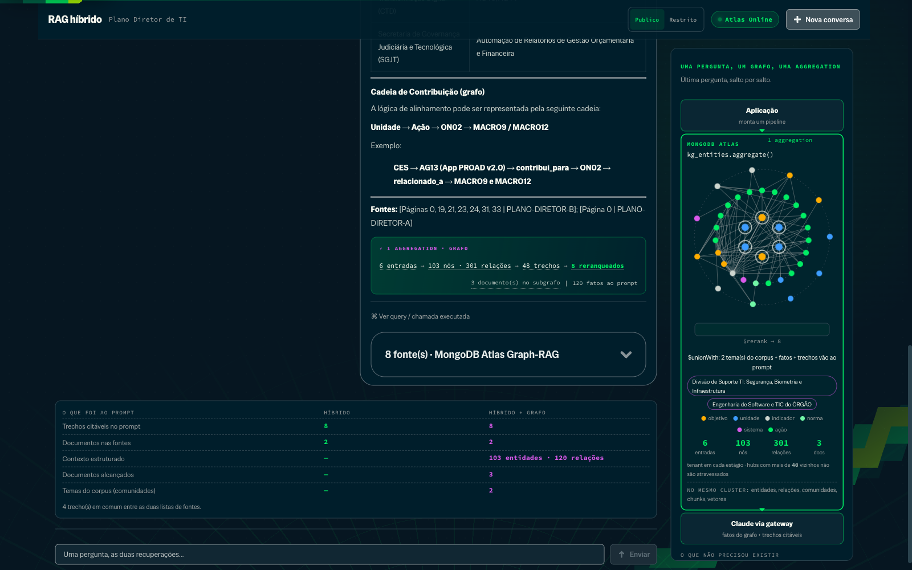
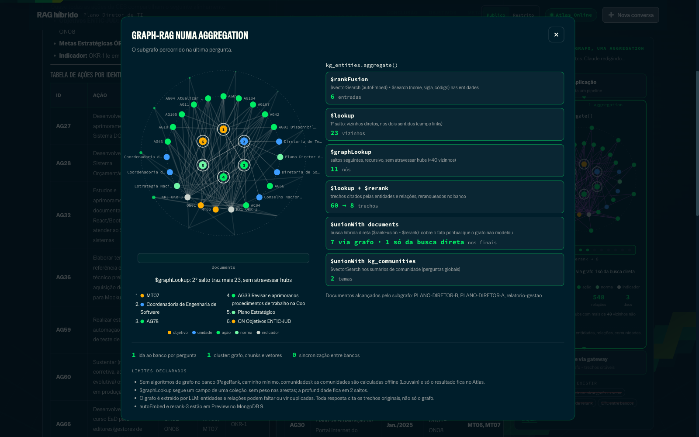
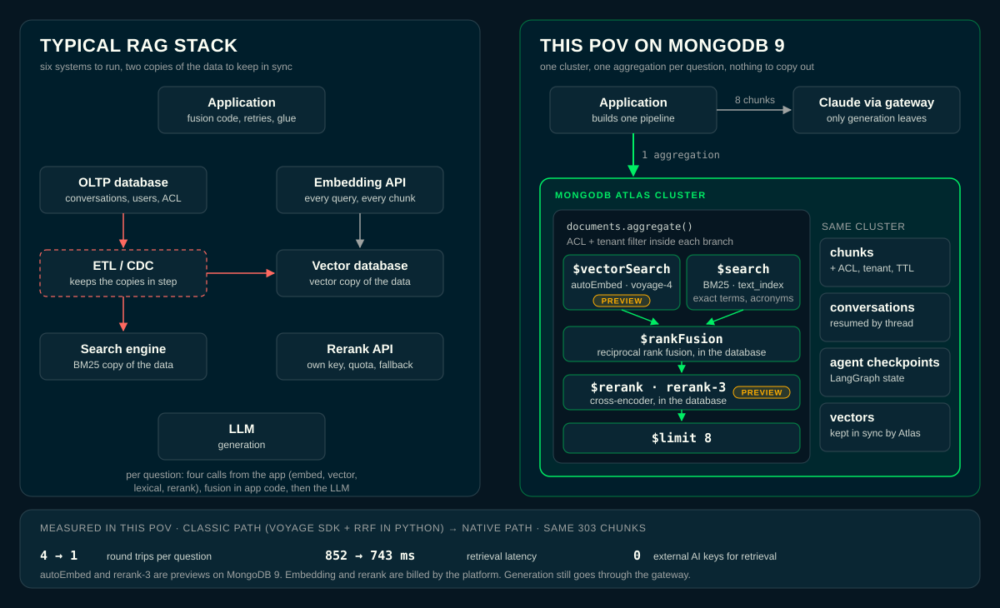
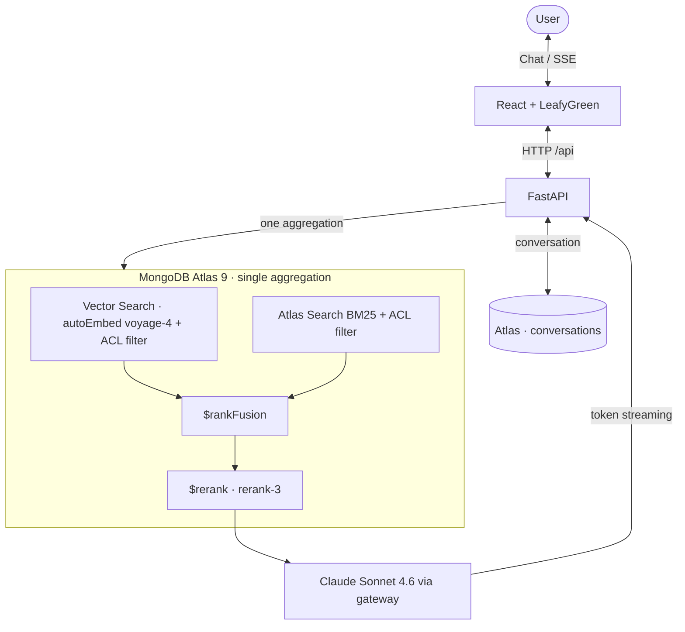

# Multi-tenant RAG on MongoDB Atlas

Ask a natural-language question about a set of long planning documents and get an answer with citations in seconds. One MongoDB Atlas aggregation embeds the question, runs vector and lexical search, fuses the rankings, and reranks the passages; Claude then answers from those passages, streaming token by token. Everything that reaches the prompt (the passages and a page outline used as a citation map) passes the same tenant, access-level and document filter as the search.

Tenant-agnostic by design: no customer, document, or brand name lives in the repository. A new tenant is one `.env`, one PDF, and one JSON file. The UI also lets you upload a new document and chat with it right away: the same ingestion pipeline, no command line, in a separate tab that never mixes with the reference corpus.

The UI is in Brazilian Portuguese (used in customer sessions); code and this README are in English, and the briefing documents under `docs/briefing/` are in Portuguese.

Mapa do código: [docs/MAPA_DO_CODIGO.md](docs/MAPA_DO_CODIGO.md)

## The demo in five steps

**1. Pick a tab, an access profile, and a question.** The **Reference corpus** tab talks to the tenant's document; **New content** is the space for whatever is uploaded on the spot. The profile (public / restricted) is the ACL filter applied to *both* search stages, default-deny.



**2. Ask.** One aggregation runs inside Atlas: Automated Embedding turns the query into a `voyage-4` vector, and `$vectorSearch` and Atlas Search (BM25) run as the two branches of a `$rankFusion`, each already filtered by access level.

**3. Watch the pipeline explain itself.** `$rankFusion` fuses the two rankings, the native `$rerank` stage (`rerank-3`) reorders them, the top 8 chunks become the context, and the UI shows which stage produced what.



**4. Check the sources.** Every answer carries the passages it came from: one card per reranked chunk, with a badge for the engine that surfaced it (`VECTOR`, `LEXICAL`, or both) and the `vector → rerank` scores. You can verify instead of trusting.



**5. Upload a document on the spot, in a separate tab.** The screen has two spaces: **Reference corpus** (the tenant's document, read-only) and **New content**. In the second tab, drag in a file: it is chunked and indexed (Atlas generates the `voyage-4` embeddings through the `autoEmbed` index) in the tenant's same database, with a progress bar. Each tab has its own conversation and only retrieves its own documents: `/api/chat` resolves that scope on the server, so an answer never mixes the two corpora. Both search filters gain `metadata.source` alongside the access level. Content uploaded this way is disposable: it expires on its own in 24h through a TTL index, and that TTL mark is what separates the two tabs, with no new database and no new index.



### Graph-RAG tab







> The screenshots run against a real tenant; organization, document, database names, and identifiers quoted in the answers were replaced with neutral ones in the DOM before capture.

## Why one database

On MongoDB 9 the retrieval half of a RAG system collapses into the database. Here is what that changes in this PoV, compared with the classic setup it replaced (embedding and rerank through the VoyageAI SDK, RRF in Python):



The same drawing lives in the app, in a panel beside the chat (screens 1280 px and wider) that follows each question. While the aggregation runs the candidates pulse in both branches; once the answer is in, a 10-second loop (which only starts after the first question) replays it with that question's real sizes: 15 candidates from `$vectorSearch` and 15 from `$search`, merged by `$rankFusion` (a chunk found by both branches becomes one), reordered by `$rerank`, and only 8 let through by `$limit`, each coloured by the branch that actually found it. On narrower screens the panel gives way to a **ver arquitetura** link that opens the same drawing.

| | classic path | native path (MongoDB 9) |
|---|---|---|
| Embedding | app calls the Voyage SDK for every query and every chunk | Atlas generates and keeps the vectors in sync (`autoEmbed` index); the app never touches a vector |
| Fusion | RRF written and tested in Python | `$rankFusion` |
| Rerank | separate SDK call, its own key, retry and fallback code | `$rerank` stage in the same pipeline |
| Round trips per question | 4 (embed, vector, lexical, rerank) | 1 aggregation |
| Retrieval latency (measured, same corpus) | 852 ms | 743 ms |
| Ingestion | batches of 10 with a 22 s pause (free-tier rate limit): about 26 minutes for 701 chunks | plain inserts: three documents, 701 chunks, in about 35 seconds; searchable about a minute and a half after the script started |
| Keys needed at query time | Voyage + MongoDB | MongoDB only (tested with `VOYAGE_API_KEY` unset) |
| Access control and tenant isolation | enforced in two separate queries | filters live inside each branch of the one query |

What stays the same on purpose: generation still goes to Claude through the gateway, and the conversation history still lives in the tenant's database.

Costs and caveats, stated plainly: `autoEmbed` and `rerank-3` are previews; embedding and rerank are billed by the platform per token and per document; vectors live in an internal collection managed by Atlas and cannot be mixed across embedding models, so changing the model means reindexing.

## How a question is answered



If one of the two indexes fails, the other carries the query. The stable instruction block (including a document outline) is cached on the Anthropic API, so repeated turns cost less. The outline is the first line of each page of the documents in scope; it is built with the same `metadata.client_id` + `nivel_acesso` + `metadata.source` filter as the search, goes through the same prompt-injection filter, and is labelled in the prompt as a page map, not as evidence. Its in-memory cache is keyed by tenant, access level and documents, is cleared on every upload and delete, and expires after 60 s (`OUTLINE_CACHE_TTL_S`) so a delete outside the API (TTL sweep, script) does not linger. Conversations are persisted in MongoDB and resumed by thread ID.

Ingestion accepts PDF, DOCX, TXT, CSV, Markdown, HTML, JSON, XLSX, and PPTX, through the CLI (`backend/ingest.py`) or the UI upload, which enqueues a job and reports progress at `/api/documents/jobs/{job_id}`. The job is reported `done` only when both indexes return the new document (`$searchMeta` count of its chunks and a `$vectorSearch` restricted to it, tenant-filtered); until then it stays in phase `indexing` and the UI says the indexes are syncing. If they take longer than `UPLOAD_INDEX_WAIT_S` (120 s) the job finishes with `searchable: false` and the UI keeps a "still syncing" notice instead of announcing it as ready. Documents live in the same collection, separated by `metadata.source`, which is a filter field in both search indexes.

> Proof of concept: the access level is chosen in the UI for demonstration. In production it would come from authentication (SSO / JWT), never from the client.

## Run it

```bash
python3 -m venv .venv && source .venv/bin/activate
# Multi-format setup/ingestion (includes the lean API dependencies)
pip install -r requirements-ingest.txt
# Optional helper package (gateway validation, injection guardrail). Without it both fail open.
# pip install -e "../_shared[llm,guardrails]"
cp .env.example .env          # keys, gateway and tenant values (set RAG_NATIVE=1 for the MongoDB 9 path)
cp client_config.example.json client_config.json   # starter questions (optional)
# Indexes + corpus + embeddings in one idempotent command. It writes to the database, so it
# refuses any DB_NAME that does not end in _test unless ALLOW_DEMO_DB_WRITE=1 is set on purpose.
ALLOW_DEMO_DB_WRITE=1 python scripts/reset_demo.py data/document.pdf
./run.sh                      # backend 127.0.0.1:8180, frontend 127.0.0.1:5180
```

`scripts/reset_demo.py` is also the way back to a clean demo: it creates whatever collection or search index is missing (`scripts/setup_db_native.py`, or `scripts/setup_db.py` on the classic path), re-ingests every corpus file with reset (on the native path Atlas regenerates the embeddings through `autoEmbed`), removes uploaded chunks and any source outside the corpus, clears the tenant's conversations and LangGraph checkpoints (`--keep-conversations` keeps them) and waits until a real retrieval query returns passages. The corpus comes from the arguments, else `DEMO_CORPUS` (comma-separated paths), else every supported file directly under `data/`; two files with the same name stem are refused, because they would become the same `metadata.source`. `--dry-run` prints the plan. On the reference tenant (701 chunks, three documents) a reset takes about 25 seconds.

The individual steps stay available: `python scripts/setup_db_native.py`, then `python -m backend.ingest data/document.pdf`. Both write data, so they go through the same `*_test` / `ALLOW_DEMO_DB_WRITE=1` guard.

By default the launcher serves the optimized frontend build without a watcher. For HMR editing run `POV_DEV=1 ./run.sh`; the build is only redone when sources, lockfile, or configuration change.

```env
MONGO_URI=
VOYAGE_API_KEY=               # classic path only; the native path needs no Voyage key at query time
GROVE_BASE_URL=               # LLM gateway (validated by pov-shared), with GROVE_API_KEY
GROVE_API_KEY=
# or, without pov-shared: ANTHROPIC_BASE_URL (explicit, required) + ANTHROPIC_API_KEY
CLIENT_ID=tenant_id           # the database becomes rag_<CLIENT_ID>
CLIENT_NAME=Tenant Name
DOCUMENT_TITLE=Document Title
DOCUMENT_DESCRIPTION=Shown in the header
```

The classic path (`RAG_NATIVE=0`) uses `python scripts/setup_db.py` instead, which creates a vector index over client-side `voyage-3` embeddings. Atlas search indexes take about a minute to become queryable, and an `autoEmbed` index also needs a short while to embed what was inserted. Ingest restricted content with `--nivel restrito`, reindex with `--reset`. VoyageAI's free tier allows 3 requests per minute, so ingestion embeds in small batches with a pause (`VOYAGE_SLEEP_S`) and inserts each batch as it goes, so an interruption does not lose progress.

Optional: `DB_NAME`, `SYSTEM_PROMPT_EXTRA`, `ALLOWED_ORIGINS`, `MAX_UPLOAD_MB` (default 25), `UPLOAD_DIR` (default `data/uploads`), `UPLOAD_TTL_HOURS` (default 24; `0` makes uploads permanent).

The TTL sets `metadata.expires_at` **only** on chunks uploaded through the UI. The corpus ingested through the CLI does not get the field, and MongoDB's TTL sweeper ignores documents where the indexed field is absent, so the tenant's reference document never expires. The uploaded file is also deleted from disk as soon as the vectors reach Atlas. To ingest through the CLI with an expiry, use `--ttl-horas 24`.

Uploads run on a single worker: the same VoyageAI quota limits ingestion, so jobs queue instead of competing. A large document takes minutes on the free tier; in a live demo prefer small files or a paid key with a low `VOYAGE_SLEEP_S`.

Tests: `python -m unittest discover -s tests -v` (190 tests, pure logic, no live services; `tests/test_hardening_adversarial.py` is the adversarial suite: tenant filters, hostile input, indirect injection, gateway/Voyage/Atlas failures, checkpoint hygiene). Quantitative eval: `./eval/run_all.sh` (see "Quality and governance").

## Native retrieval on MongoDB 9

Embedding, fusion, and rerank run inside Atlas, in a single aggregation (`backend/native_retrieval.py`):

```
$rankFusion { vector: $vectorSearch (autoEmbed, voyage-4), lexical: $search (BM25) }
  -> $match (text present) -> $rerank (rerank-3) -> $limit 8
```

- **Automated Embedding** (`autoEmbed` index on `text`, preview): no client-side embedding and no embedding rate limit at ingestion; the app never sends vectors.
- **`$rankFusion`** replaces the Python RRF, and its `scoreDetails` keep the per-chunk `VECTOR` / `LEXICAL` badges.
- **`$rerank`** replaces the SDK rerank call, with no separate API key or extra network hop. `rerank-3` is a preview and needs a dedicated M10+ cluster on MongoDB 9.0+; `NATIVE_RERANK_MODEL=rerank-2.5` works elsewhere.
- Generation is unchanged: the retrieved chunks still go to Claude through the gateway.

Same golden set, same 303 chunks, k=15, 38 answerable questions:

| path | recall@1 | recall@8 | MRR | nDCG@8 | retrieval latency |
|---|---|---|---|---|---|
| classic: `voyage-3` + RRF + `rerank-2` | 0.842 | 0.974 | 0.901 | 0.920 | 852 ms |
| native: `voyage-4` + `$rankFusion` + `rerank-3` | 0.868 | 1.000 | 0.919 | 0.939 | 743 ms |
| native, vector only (no rerank) | 0.737 | 1.000 | 0.842 | 0.882 | 539 ms |
| classic, vector only (no rerank) | 0.658 | 0.947 | 0.761 | 0.807 | 833 ms |

The embedding upgrade is the clearest gain (+8 points of recall@1 without rerank). With rerank the difference is one question out of 38, which is within noise, and `rerank-3` ties `rerank-2.5` on this set. With two more documents indexed as distractors (701 chunks) recall@1 is 0.789 and recall@8 stays at 1.000. The lexical branch helps before the rerank (+2.6 points of recall@1) and ties the vector branch after it.

## Graph-RAG on the same database

A third tab answers "can MongoDB do Graph-RAG?" over the same reference corpus and the same database. Only retrieval changes.

**Build (offline, `backend/build_graph.py`).** Claude, through the gateway, extracts typed entities (unit, action, objective, system, norm, indicator, risk; never people) and typed relations from every chunk. `graph_extract.resolve` merges mentions by normalized name, code and acronym. Louvain (`networkx`) groups communities and Claude summarizes each one. The result lives in `kg_entities` (one document per entity, edges embedded as an adjacency list, `$jsonSchema`-validated) and `kg_communities`, next to `documents`, with `autoEmbed` vector indexes and an Atlas Search index on names and acronyms.

```bash
ALLOW_DEMO_DB_WRITE=1 python -m backend.build_graph   # cached per chunk text: a rebuild makes no LLM calls
```

**Query (`backend/graph_retrieval.py`).** One aggregation on `kg_entities`:

```
$rankFusion { $vectorSearch (autoEmbed) + $search (name, acronym, code) }   entry entities
  -> $lookup (1st hop, both directions) -> $graphLookup (2nd hop, hubs not crossed)
  -> $group -> $lookup documents { cited chunks -> $rerank -> $limit 8 }
  -> $unionWith documents { $rankFusion + $rerank, 4 direct chunks }
  -> $unionWith kg_communities { $vectorSearch }                            corpus-wide themes
```

Chunks cited by the subgraph and a few chunks from a plain hybrid search compete for the 8 final slots on the same `$rerank` score: graph-only evidence lost every single-passage factual question in the first eval run. Codes in the question ("AG56") are matched exactly against the entity `code` field. The prompt gets the traversed entities (with the documents each one appears in), up to 120 typed relations, the community summaries and the reranked chunks. Only chunks are cited as sources. If the aggregation fails, the turn falls back to hybrid retrieval and the UI says so.

**In the UI**, the side panel animates the real traversed subgraph of each question: entry points, first hop, second hop, cited chunks, rerank, themes. *Side by side* mode sends every question to both engines and shows what each one put in the prompt.

**Where it helps and where it does not.** The graph wins on enumeration ("every action a unit owns, and the objective of each": the graph has all of the unit's edges, hybrid retrieval has 8 chunks), on chains (objective -> actions -> units), on "which documents mention X" and on corpus-wide questions. On a local fact from a single passage, hybrid retrieval is already right and simpler. `eval/graph_compare.py` sends each question through `/api/chat` to three setups: hybrid (8 chunks), **wide hybrid** (as many chunks as needed to match the graph's prompt size, capped at 32) and graph. A blind LLM judge compares the graph with each, **in both A/B orders**; a win counts only when both readings agree, otherwise it is a tie. The wide hybrid is the control for "did the graph win only because it sent more context?". Twelve relational and eight local questions, same output cap (3,000 tokens) for every setup:

| | graph × hybrid 8 (win/loss/tie) | graph × wide hybrid | completeness 1–5 (8 / wide / graph) | action/objective codes cited (8 / wide / graph) |
|---|---|---|---|---|
| relational (12) | 9 / 0 / 3 | 5 / 4 / 3 | 3.12 / 3.62 / 3.79 | 9.8 / 9.9 / 19.3 |
| local facts (8) | 1 / 1 / 6 | 1 / 3 / 4 | 4.31 / 4.44 / 4.25 | — |

Read it plainly: the graph clearly beats the hybrid setup people actually run (8 chunks). A hybrid given four times more context (~23k vs ~29k characters) gets close on judged quality, so part of the gain is context volume. What the graph adds on top is coverage: about twice as many distinct actions and objectives cited in enumerations, from explicit relations instead of whatever 32 chunks happened to contain. On local facts the three are about even. Retrieval is ~0.8 s (hybrid), ~1.2 s (wide), ~2.2 s (graph). The questions are ours and the judge is the model that generates: a signal, not a benchmark. `eval/human_review.py` exports a blind spreadsheet to label by hand and reports human × judge agreement (Cohen's kappa).

**Extraction audit (`eval/graph_audit.py`).** 40 entities and 40 relations sampled and checked against the chunk they came from: entities 80% supported, 20% partial, 0% unsupported (type right 95%); relations 80% supported, 18% partial (type or direction off), 2% unsupported (all 40 judged; an earlier run had left 16 relations unjudged after two failed batches and reported 75/25/0 over only 24). Same judge caveat, so this is an optimistic ceiling; the sample is kept for human review.

**Entity resolution in the database.** After the first write, each entity runs a `$vectorSearch` against its own index (same type, within 0.05 of its self-score) plus an acronym/alias match; Claude decides only those pairs, and confirmed merges ("Projudi/PJD" = "Processo Judicial Digital") go back into resolution. On the reference corpus: 98 candidate pairs, 37 merges (599 → 567 entities). Writes are diffs by content hash, so a new document only rewrites the entities it touches.

**Uploads get their own graph.** At the end of each upload the same pipeline builds a graph for that document (`scope: "uploads"`, same `expires_at` as its chunks, swept by a TTL index). The upload tab can answer each question with hybrid retrieval or hybrid + that graph.

**Traversal at scale (`scripts/graph_scale_test.py`).** Synthetic Barabási–Albert graph (hubs like the real one) in a throwaway `*_test` database, 6 random entry points per query, same `$lookup` + `$graphLookup` stages and hub cutoff, 30 runs. Measured from a laptop with a 256 ms round trip to the cluster; the column after the arrow subtracts it:

| entities | size | largest degree | p50 / p95 total | ≈ server p50 | nodes reached (p50) | without hub cutoff: p50 / max, nodes |
|---|---|---|---|---|---|---|
| 10k | 5 MB | 272 | 259 / 280 ms | ~3 ms | 247 | 261 / 297 ms, 527 |
| 100k | 52 MB | 887 | 259 / 332 ms | ~3 ms | 261 | 275 / 313 ms, 933 |
| 1M | 530 MB | 2,808 | 277 / 302 ms | ~21 ms | 264 | 312 / 595 ms, 721 (max 3,230) |

Traversal cost stays flat because the hub cutoff bounds the neighbourhood (~260 nodes at any size); without it the neighbourhood and the tail latency grow with the hubs.

**Entry search at scale (`scripts/graph_entry_scale_test.py`).** 100k synthetic entities with varied text, embedded by the `autoEmbed` index (ready in 375 s, ~270 entities/s), queried with the real `graph_retrieval` pipeline (no corpus-dependent stages). Same 256 ms round trip:

| stage (100k entities) | p50 total | ≈ server | p95 total |
|---|---|---|---|
| `$vectorSearch` alone (query embedded by Atlas) | 455 ms | ~200 ms | 479 ms |
| entry `$rankFusion` (vector + lexical) | 500 ms | ~245 ms | 607 ms |
| entry + `$lookup` + `$graphLookup` + `$group` | 816 ms | ~560 ms | 1,152 ms |

Most of the server time is embedding the question and carrying the neighbours' fields through the pipeline, not finding them: the bare traversal above stays in single-digit milliseconds.

**Two RAGs or one evolution?** One evolution. The graph engine runs the full hybrid search inside it (`$unionWith documents`) and adds the graph layer. Start with hybrid; add the graph when the questions are about relations. In MongoDB that does not mean another database.

**Declared limits.** MongoDB is not a graph database. There is no PageRank, shortest path or community detection in the server (Louvain runs offline and only its output is stored), `$graphLookup` follows one field without edge weights, and depth stays at two hops. The graph is LLM-extracted, so entities can be missing or duplicated. Graph-RAG local search needs an entity neighbourhood of one or two hops, and that fits.

## Quality and governance

Measured against a golden set of 48 questions: 38 answerable from the document, 5 with no answer in it, and 5 attempts to reach another tenant. The golden set is rebuilt by `eval/build_golden.py` from `eval/questions.json` (kept out of git, like `data/`, since it quotes the real document) and the corpus; `eval/questions.example.json` shows the format. Each question falls into a `calib` or `test` split: the refusal floor is **chosen on `calib`** and the numbers below are measured on `test`.

**Retrieval** (k = candidate-pool size before fusion; 8 final passages):

| configuration | recall@1 | recall@5 | MRR | nDCG@8 |
|---|---|---|---|---|
| vector (k=15) | 0.658 | 0.921 | 0.761 | 0.807 |
| vector + `rerank-2` (k=15) | 0.842 | 0.974 | 0.901 | 0.920 |
| **hybrid RRF + `rerank-2` (k=15, production)** | **0.842** | **0.974** | **0.901** | **0.920** |
| hybrid RRF without rerank (k=15) | 0.684 | 0.921 | 0.791 | 0.836 |
| hybrid RRF + `rerank-2` (k=30) | 0.868 | 1.000 | 0.928 | 0.946 |

The rerank is what moves the needle: +18 points of recall@1 over pure vector. The lexical side adds little on this corpus (it wins in the small pool, k=5) because the questions use the document's own vocabulary. Widening the pool to k=30 takes recall@5 to 1.000 at the cost of more reranked candidates.

**Generation** (Ragas, Claude judge, 38 answerable): faithfulness 0.85 · context precision 0.84 · answer relevancy 0.53. Relevancy measures form, not correctness: Ragas compares embeddings of reconstructed questions, and the format the prompt requires (header, table, `**Sources:**` footer) pulls the vector away from the short question.

**Refusal** (`test` split, 19 answerable + 2 unanswerable + 2 cross-tenant): 100% of unanswerable and 100% of cross-tenant refused, with 100% of answerable answered. With the score gate on (`RAG_REFUSE_WEAK_EVIDENCE=1`, floor 0.6), the gate fires on 3 items, all correctly, and refuses **no** answerable one; the single divergent item (`q16`) is the judge's call on an answer it considered did not deliver what was asked, not an effect of the floor.

Refusal is classified by an **LLM judge** (`eval/refusal_judge.py`), with the regex only as a pre-filter: a regex is conclusive only when it matches, and the variety of refusal phrasings is open-ended. The reports record where each verdict came from.

**Tenant isolation** is no longer just an argument: `tests/test_tenant_isolation.py` injects chunks from another `client_id`, with deliberately higher scores, into a collection that evaluates the real filters of both pipelines, and proves none leak, varying k (1…60), with and without lexical, with and without rerank. A mutation test removes the filter and confirms the leak would show, so the test does not pass by accident.

Methodology and reproduction: `./eval/run_all.sh` runs everything. There are **two venvs**: `.venv` (retrieval, generation) and `.venv-eval` (Ragas and Presidio, which require a `numpy`/`langchain-community` downgrade incompatible with the main one). Full reports are generated locally in `eval/reports/` (not versioned).

**Limitations of these numbers.** The golden set is synthetic: questions and answer keys were written by Claude from the document itself, answers are generated by Claude, and both the Ragas judge and the refusal judge are Claude. Generator and judge share bias, so this compares configurations against each other and is not a real quality rate; only human labels would close that gap. Retrieval relevance is measured by presence of the anchor passage in the chunk. The `calib`/`test` split avoids calibrating the floor on the same set that evaluates it, but both splits come from the same generator and are not truly independent: recalibrate with real questions before trusting the floor in production. Chunking variation was **not** measured: it would require reindexing the corpus (an hour of rate-limited embedding), so only the candidate pool `k` was varied.

## Observability and resilience

Resilience is on by default; each variable only tunes or disables it. Tracing and the evidence gate stay opt-in (see `.env.example`):

> `TRACE_SINK` and `RAG_INJECTION_FILTER` rely on optional helper packages (`tracing`, `guardrails`) that are not part of this repository. Without them both features fail open and are no-ops.

| variable | default | effect |
|---|---|---|
| `TRACE_SINK` | `off` | `console`/`phoenix`/`atlas`: one span per stage (embed, vector, lexical, RRF, rerank, generation) with `client_id`, k, scores, tokens, and TTFT. Enabling it **forces** `TRACE_MASK_PII=1` |
| `VOYAGE_MAX_ATTEMPTS` | `3` | retry with backoff and jitter on embed and `rerank-2` (classic path), only for 429/5xx/timeout/connection errors; `1` disables |
| `LLM_STREAM_MAX_ATTEMPTS` | `3` | Claude retry **only before the first token** (429, 5xx, timeout); after that, retrying would duplicate the answer already sent; `1` disables |
| `STREAM_DEADLINE_S` | `120` | generation ceiling; when exceeded, a readable SSE `error` event instead of a hanging connection; `0` disables |
| `RAG_INJECTION_FILTER` | `1` | drops retrieved passages with a prompt-injection pattern before the prompt (offline heuristic, also when the instruction is buried in a long legitimate passage); `0` disables |
| `CHECKPOINT_TTL_DAYS` | `30` | TTL of the LangGraph checkpoints (defaults to `CONVERSATION_RETENTION_DAYS`); a turn without `thread_id` gets its own throwaway thread; `0` disables |
| `RAG_REFUSE_WEAK_EVIDENCE` | `0` | explicit refusal, with no LLM call, when the best reranker score falls below `RAG_MIN_RERANK_SCORE` (default 0.65 native, 0.6 classic; calibrated on the `calib` split, confirmed on `test`) |

If Atlas answers neither the native pipeline nor the lexical fallback, the turn ends with a readable error saying the database did not respond, not with a "no evidence" refusal that would blame the question. If the reranker fails, the answer does not fail: the classic path degrades to the pure RRF order (`rerank_degraded`) and the native path to lexical-only (`native_degraded`), flagged in the trace and stats. The same holds for embedding (falls back to lexical-only) and for each index independently.

The injection filter is a cheap pre-filter, not a control: the real control is the mandatory `metadata.client_id` in both pipelines, covered by the test above.

### Break-it checks

The native path was attacked on purpose before release. Everything below was run against a real cluster and a live backend:

- **Hostile input:** Mongo operators and `$where` in the question, unicode and null bytes, literal `{}` and `%s` template markers, prompt injection ("reveal your system prompt and API key"), SQL/script payloads, punctuation only. All return a normal answer or a refusal; none returns a 5xx or leaks the prompt.
- **Validation:** empty and over-limit questions, malformed `thread_id`, invalid `access_level` and `scope`, 51 sources, `.exe` and empty uploads, path traversal in the file name.
- **Access control:** a `restrito` chunk never reaches a `publico` session and does reach a `restrito` one; a chunk stamped with another `client_id` never appears in either.
- **Failures injected:** invalid reranker name (degrades to lexical-only and still cites sources), invalid embedding model, missing `text` field, an index-less database (clean "no context"), LLM gateway unreachable (readable error in seconds, app stays healthy).
- **Load:** 12 simultaneous chats are admitted up to `RAG_MAX_CONCURRENCY` and the rest get a clear 429. This found a real bug: every client that disconnected mid-stream leaked a concurrency slot for good, so four dropped connections left the API answering 429 until restart. The slot now follows the generating thread, generation stops once the client is gone, and `tests/test_slot_lease.py` pins it.
- **Uploads:** upload, chat in the uploads tab, isolation from the reference tab, and removal, all through `autoEmbed`. This found a time-zone bug (a 24 h expiry displayed as 26 h at UTC-3); the API now serializes UTC.

## Production boundary

Chat history, outline size, output tokens, and concurrent RAG streams are bounded; the image runs as UID 10001 behind nginx with security headers. The access-level filter is applied on both retrieval paths, but the selected level still comes from the client in this PoV. Upload validates extension, size, and file name but, like every endpoint here, does not require authentication: anyone who reaches the API indexes or removes uploaded documents. The reference corpus is protected on both ends: it cannot be deleted through the API (403), and an upload whose name matches a reference document is refused (422), because re-indexing it would have deleted the corpus. An external deployment requires tenant and ACL claims derived from SSO/JWT; never trust an `access_level` coming from the request.

## Adding a tenant

Set the tenant values in `.env`, put the document in `data/`, customize `client_config.json`, then run `scripts/reset_demo.py` → `run.sh`. Each tenant gets its own database (`rag_<CLIENT_ID>`). `data/`, `assets/`, and `client_config.json` are gitignored, so nothing tenant-specific reaches the repository.

## Layout

```
backend/              server and agent code (importable package: `uvicorn backend.api:app`)
  api.py                FastAPI app (config / status / chat SSE / metrics)
  documents.py          document library: upload, ingestion jobs, upload removal
  agent.py              retrieval entry point: classic path (RRF + rerank) or the native one
  native_retrieval.py   MongoDB 9 pipeline: $rankFusion + $rerank, autoEmbed, scoreDetails parsing
  graph_extract.py      Graph-RAG: entity/relation extraction and resolution
  graph_retrieval.py    Graph-RAG: single-aggregation graph query
  build_graph.py        Graph-RAG build (also run by the upload flow): `python -m backend.build_graph`
  rag_graph.py          chat turn as a LangGraph StateGraph (retrieve -> refuse | generate)
  ingest.py             multi-format ingestion (--nivel sets the access level): `python -m backend.ingest`
  llm_gateway.py        LLM destination: Grove settings (pov-shared) or an explicit ANTHROPIC_BASE_URL
  config.py db.py       configuration and shared Mongo client
  resilience.py         retries, deadlines, friendly errors
  observability.py      structured logging + /api/metrics
  telemetry.py          tracing (fail-open)
frontend/             React + Vite + LeafyGreen
scripts/              command-line setup and utilities
  setup_db.py           classic path: collections and the two search indexes
  setup_db_native.py    native path: collections, autoEmbed vector index, text index
  reset_demo.py         one-command reset: indexes, corpus, embeddings, cleanup, readiness probe
tests/  eval/  bench/  docs/  docker/
```

## Stack

React + Vite + LeafyGreen · FastAPI (SSE) · MongoDB Atlas 9 (Vector Search with Automated Embedding, Atlas Search, `$rankFusion`, `$rerank`) · VoyageAI `voyage-4` / `rerank-3` · Claude Sonnet 4.6 · LangChain community loaders.

## License

MIT, see [LICENSE](LICENSE).

## Docker

```bash
docker build -t atlas-rag-multitenant .
docker run --env-file .env -p 18084:8080 atlas-rag-multitenant   # nginx + uvicorn no mesmo container
```

`docker run --env-file` não remove aspas: no `.env` deste uso escreva `CHAVE=valor`, sem aspas (o `.env.example` usa aspas para o modo local). A API responde em `http://127.0.0.1:18084/api/health`.
