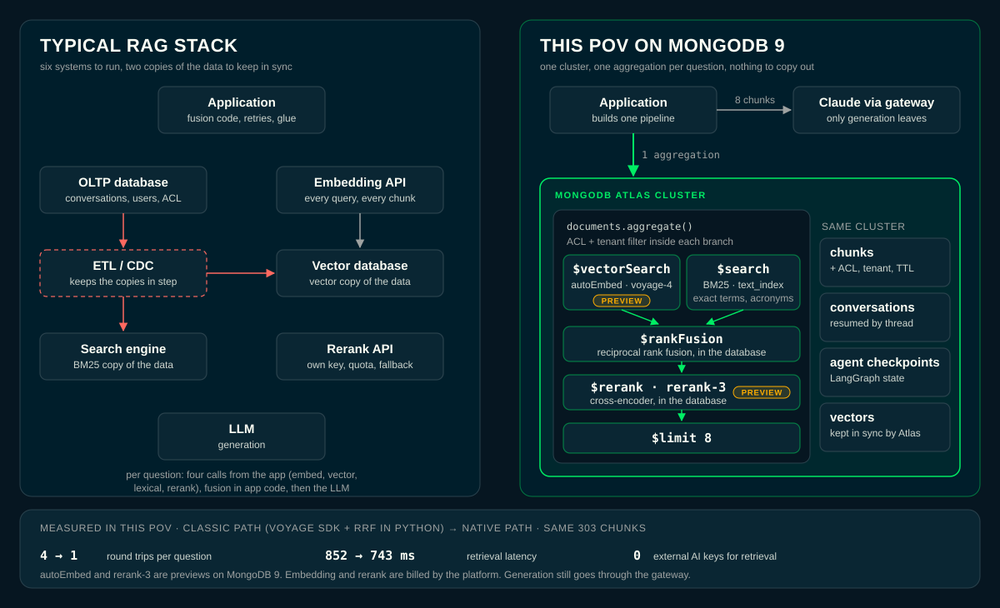

# Arquitetura — RAG multi-tenant

> Objetivo deste documento: em 5 minutos, qualquer engenheiro (ou o gestor perguntando "como isso funciona?") entende o desenho, a stack e o porquê de cada decisão. Consultas concretas (queries, índices, pipelines) estão em `queries.md`. Telas e fluxos de UI estão em `ui-flows.md`.

## O que é

Assistente RAG (Retrieval-Augmented Generation) sobre **MongoDB Atlas Vector Search**, feito para responder perguntas em cima de documentos institucionais (deploy de referência: documento público de planejamento de TI — PDTIC). A stack é deliberadamente **agnóstica de documento e de tenant**: trocar de cliente é trocar variáveis de `.env`, não código.

Critério que define "arquitetura certa" aqui: adicionar um tenant novo = novos valores no `.env` + documento em `data/` + `client_config.json`. Zero mudança de código Python.

## Stack

| Camada | Tecnologia | Onde |
|---|---|---|
| Banco / busca | MongoDB Atlas (Vector Search + Atlas Search/BM25) | `backend/db.py`, `scripts/setup_db.py` |
| Embeddings + rerank | Nativo no Atlas (`RAG_NATIVE=1`): Automated Embedding `voyage-4`, `$rankFusion`, `$rerank` `rerank-3`. Caminho clássico: VoyageAI `voyage-3` + `rerank-2` via SDK | `backend/native_retrieval.py`, `backend/agent.py`, `backend/ingest.py` |
| Geração | Claude (`claude-sonnet-4-6`) via `langchain_anthropic.ChatAnthropic`, sempre atrás de um gateway explícito: `GROVE_BASE_URL` validado pelo `grove_client` do pacote `pov-shared`, ou `ANTHROPIC_BASE_URL` declarado; sem destino padrão implícito | `backend/llm_gateway.py`, `backend/api.py` |
| API | FastAPI, streaming SSE | `backend/api.py` |
| Frontend | React + Vite + LeafyGreen (design system MongoDB) | `frontend/src/` |
| Deploy | container único: nginx serve o build do frontend e faz proxy de `/api` pro uvicorn | `Dockerfile`, `docker/start.sh`, `nginx.conf` |

## Fluxo de dados (pergunta → resposta)

```
Usuário digita/clica pergunta na UI
  → POST /api/chat (SSE)
  → backend/api.py resolve escopo (workspace/tenant/ACL)
  → backend/agent.py::retrieve_context(query)
       Caminho nativo (RAG_NATIVE=1), um único aggregation no Atlas:
       1. $rankFusion com dois ramos: $vectorSearch (autoEmbed voyage-4: o Atlas
          embeda a pergunta) e $search (BM25), cada um filtrado por client_id +
          nivel_acesso + source
       2. $rerank (rerank-3) reordena o conjunto fundido; $limit 8
       3. scoreDetails devolve o ramo (e o score bruto) de cada chunk: alimenta os badges
          Falha do Atlas degrada para lexical-only (native_degraded)
       Caminho clássico (RAG_NATIVE=0): embed voyage-3 com cache LRU, $vectorSearch e
       $search em paralelo, RRF k=60 em Python, rerank-2 pelo SDK da Voyage
  → backend monta SystemMessage/HumanMessage/AIMessage (à mão, sem template)
  → Claude gera a resposta em streaming (SSE: meta → token* → done)
  → UI mostra EngineStrip + Sources (evidência) ANTES do texto, depois o
    texto token a token
  → conversa persistida em MongoDB (coleção `conversations`, best-effort)
```

O evento `meta` (fontes + stats do funil de recuperação) chega **antes** do primeiro `token`, de propósito: na demo, o cliente vê a recuperação acontecer antes da redação — fica claro que o LLM respondeu em cima de busca real, não de memória.

## Por que um banco só



Numa stack RAG típica, cada estágio da recuperação é um sistema à parte: o banco OLTP guarda conversas, usuários e ACL; um ETL/CDC copia os dados para um motor de busca (BM25) e para um banco vetorial; uma API de embedding é chamada a cada pergunta e a cada chunk; uma API de rerank tem chave, cota e fallback próprios; e a fusão dos rankings é código na aplicação. No caminho nativo desta PoV (`RAG_NATIVE=1`), tudo isso vira **uma aggregation** na coleção `documents` (`backend/native_retrieval.py`), e os dados operacionais ficam no mesmo cluster:

| Peça | Stack típica | Nesta PoV |
|---|---|---|
| Dado operacional (conversas, checkpoints do LangGraph, ACL, TTL) | banco OLTP | mesmo cluster Atlas (`conversations`, `rag_<CLIENT_ID>`, `metadata.*`) |
| Vetores | banco vetorial + sincronia | `$vectorSearch` com `autoEmbed` na mesma coleção; o Atlas mantém os vetores |
| Busca léxica | motor de busca + ETL | `$search` (BM25) no `text_index` |
| Embedding | API externa chamada pela app | `voyage-4`, gerado pelo Atlas |
| Fusão | código na app | `$rankFusion` |
| Rerank | API externa | `$rerank` (`rerank-3`) |

Medido nesta PoV (caminho clássico contra nativo, mesmos 303 chunks): 4 idas por pergunta viram 1, a recuperação cai de 852 ms para 743 ms e nenhuma chave de IA externa é usada na recuperação (testado com `VOYAGE_API_KEY` vazia). Só a geração sai do banco (Claude via gateway). O ganho é de **operação** (menos sistemas, sem sincronia, ACL e filtro de tenant num lugar só), não de qualidade: com rerank, a diferença de recall é ruído. `autoEmbed` e `rerank-3` estão em Preview.

## Por que híbrido (vetorial + lexical) e não só vector search

Decisão central da PoV, e a pergunta que sempre aparece em reunião:

- **Vetorial sozinho** erra em sigla, número de norma/processo e nome próprio — comum em documento jurídico/administrativo.
- **Lexical sozinho** erra quando o usuário pergunta com outras palavras (paráfrase).
- **RRF** funde os dois ranqueamentos sem precisar normalizar scores de escalas diferentes (que nem são comparáveis entre si).
- **Rerank** é o estágio que mais melhora a resposta por token gasto — separa "8 chunks que casaram" de "os 8 chunks que respondem".

As duas buscas rodam de fato em paralelo (`ThreadPoolExecutor`, uma thread para a vetorial) e **cada uma tolera a falha da outra**: se o índice vetorial cair, a lexical sozinha responde (e vice-versa), com log indicando qual caiu. O rerank também degrada: se a chamada à VoyageAI falhar, mantém a ordem do RRF. Ver `backend/agent.py::retrieve_context` e detalhamento em `queries.md`.

## Componentes principais

| Arquivo | Papel |
|---|---|
| `backend/agent.py` | entrada da recuperação: caminho nativo (`backend/native_retrieval.py`, uma aggregation) ou clássico (embedding → vector search + lexical search → RRF → rerank), filtro de prompt injection nos trechos recuperados. Chamado pelo nó `retrieve` de `backend/rag_graph.py`. |
| `backend/rag_graph.py` | o turno de chat como `StateGraph` do LangGraph: `retrieve` → (`refuse` \| `generate`), checkpoint em `MongoDBSaver` (banco `rag_<CLIENT_ID>`, TTL de 30 dias) ou `MemorySaver` sem `MONGO_URI`. |
| `backend/api.py` | app FastAPI: streaming SSE do chat, montagem manual das mensagens (não usa `ChatPromptTemplate` porque contexto/histórico podem conter `{}` literais que um template interpretaria como variável), outline cacheado, endpoints de config/status/histórico/documentos. |
| `backend/documents.py` | biblioteca de documentos: valida upload, enfileira ingestão em worker único, expõe jobs, separa os dois "workspaces" (corpus base vs. uploads de demo) via TTL, protege o corpus base contra remoção. |
| `backend/ingest.py` | loader multi-formato (PDF/DOCX/TXT/CSV/MD/HTML/JSON/XLSX/PPTX), chunking (`RecursiveCharacterTextSplitter`, 800/150), embedding em lotes com pausa de 22s (tier gratuito VoyageAI: 3 req/min). |
| `backend/db.py` | `MongoClient` singleton (pool de conexão reusado em todo o processo) + verificação de identidade do tenant no boot. |
| `backend/config.py` | toda a configuração de tenant vem de variáveis de ambiente (`CLIENT_ID`, `CLIENT_NAME`, etc.), sem default silencioso para `CLIENT_ID`. |
| `scripts/setup_db_native.py` / `scripts/setup_db.py` | scripts administrativos idempotentes (nativo / clássico): coleções, índices TTL e os dois índices de busca (`vector_index`, `text_index`). Recusam banco que não termina em `_test` sem `ALLOW_DEMO_DB_WRITE=1`. |
| `scripts/reset_demo.py` | reset da demo num comando: índices, reingestão do corpus base (o Atlas regenera os embeddings via `autoEmbed`), remoção de uploads e fontes fora do corpus, limpeza de conversas e checkpoints, espera até uma consulta real devolver trechos. Mesma guarda de banco. |
| `backend/observability.py` | logging estruturado, request-id, `/api/metrics`, `/metrics` (Prometheus), `/api/health`. |

## Graph-RAG no mesmo banco (aba Graph-RAG)

Pergunta do cliente que motivou: "dá para fazer Graph-RAG no MongoDB?". A aba responde no mesmo banco, sem outro motor.

**Evolução, não alternativa:** o motor graph roda a busca híbrida inteira dentro dele (`$unionWith documents`) e soma a camada do grafo. Comece pelo híbrido; ligue o grafo quando as perguntas forem sobre relações. O eval final (12 relacionais + 8 locais, juiz nas duas ordens) mostra o grafo vencendo com folga o híbrido padrão de 8 trechos (9/0/3) e ficando perto do híbrido com 4× mais contexto (5/4/3), com o dobro de ações e objetivos citados nas enumerações; nos fatos locais os três empatam na prática. Parte do ganho é volume de contexto; o que é só do grafo é a cobertura de relações explícitas.

- **Construção (offline, `backend/build_graph.py`):** Claude extrai entidades (unidade, ação, objetivo, sistema, norma, indicador, risco) e relações tipadas de cada chunk do corpus base, sem pessoas. `graph_extract.resolve` funde menções (nome normalizado, código, sigla: "CES" e "Coordenadoria de Engenharia de Software" viram um nó; código de ação é por plano, código de objetivo é global). Louvain (`networkx`) agrupa comunidades, e Claude resume cada uma. Tudo vai para `kg_entities` e `kg_communities` no `DB_NAME`, ao lado de `documents`.
- **Consulta (`backend/graph_retrieval.py`):** um aggregation em `kg_entities`: `$rankFusion` (`$vectorSearch` autoEmbed + `$search` nome/sigla/código) acha 6 entidades de entrada; `$lookup` traz o 1º salto e `$graphLookup` o 2º, sem atravessar hubs; `$lookup` em `documents` com `$rerank` traz os 8 trechos citados pelo subgrafo; `$unionWith` traz 2 sumários de comunidade.
- **Prompt:** entidades do subgrafo com os documentos onde aparecem, até 120 triplas (as das entradas primeiro), temas e os trechos. O modelo é instruído a mostrar a cadeia (A → B → C) e a citar páginas só dos trechos.
- **Onde ganha:** enumeração ("quais ações a unidade X conduz": o grafo traz todas as arestas da unidade; o híbrido traz 8 trechos), cadeias (objetivo → ações → unidades), presença em vários documentos (`sources` da entidade) e perguntas globais (comunidades). **Onde não ganha:** fato local de um trecho só (prazo de uma ação, um número): o híbrido já acerta e é mais simples.
- **Limites declarados (também na UI):** sem algoritmos de grafo no banco; `$graphLookup` segue um campo, sem peso de aresta; grafo extraído por LLM pode errar ou faltar; a profundidade fica em 2 saltos. Grafo só do corpus base (uploads expiram e não entram).
- **Degradação:** falha do aggregation ou nenhuma entidade de entrada → busca híbrida nativa, com aviso.

## O turno como grafo (LangGraph), sem agente

`backend/rag_graph.py` organiza o turno em três nós: `retrieve` (chama `agent.retrieve_context`, decide se há evidência), `refuse` (recusa sem chamar o LLM, só com `RAG_REFUSE_WEAK_EVIDENCE=1` ou sem trecho nenhum) e `generate` (stream do Claude). Não há ferramentas nem laço de raciocínio: é um pipeline fixo, por isso não existe `agent-behavior.md`. O endpoint `/api/chat` é síncrono e roda o grafo numa thread, drenando uma fila para o SSE.

Checkpoints: `MongoDBSaver` grava em `rag_<CLIENT_ID>` (`langgraph_checkpoints`, `langgraph_checkpoint_writes`) com TTL (`CHECKPOINT_TTL_DAYS`, padrão igual a `CONVERSATION_RETENTION_DAYS`, 30). Um turno sem `thread_id` recebe uma thread própria (`anon-<uuid>`); antes todos iam para a mesma thread nula, empilhando estado de pessoas diferentes.

## Multi-tenancy

Um database Atlas por tenant: `rag_<CLIENT_ID>`. `CLIENT_ID` nomeia o banco e é obrigatório — o boot falha sem ele (a menos que `ALLOW_DEFAULT_TENANT=true`, modo dev explícito). `backend/db.py::verify_tenant_identity` grava/confere uma identidade carimbada em `_meta` para pegar um `MONGO_URI` reaproveitado de outro tenant (erro operacional plausível: `.env` copiado ou esquecido).

Dentro de um tenant, dois "espaços de trabalho" isolados na mesma base/coleção:

- **`base`** — corpus de referência, ingerido por CLI, nunca expira, não pode ser removido pela tela (403).
- **`uploads`** — conteúdo enviado durante a demo pela UI, expira sozinho via TTL (`UPLOAD_TTL_HOURS`, padrão 24h).

A fronteira entre os dois é a **presença/ausência do campo `metadata.expires_at`** — nenhum banco, índice ou campo novo foi criado para isso. Ver `queries.md` para os detalhes de índice/TTL e `ui-flows.md` para como isso aparece nas duas abas.

## Controle de acesso (`nivel_acesso`) — decidido no servidor

`"publico"` ou `"restrito"`. Desde 2026-11-12 o nível vem de um **token assinado** (`Authorization: Bearer`, HS256, `backend/auth.py`) com `tid` (tenant), `lvl` e `exp`, verificado no servidor; sem token, só `publico`; token inválido, expirado ou de outro tenant → 401. O `access_level` do corpo só **reduz** o concedido. O botão da UI pede o token a `POST /api/session` (emissor de demonstração; `RAG_DEMO_LOGIN=0` desliga, e em produção o token vem do IdP). O público sai sem credencial. O restrito, com `RAG_DEMO_PASSWORD` definida, exige essa senha (comparação em tempo constante, `auth.demo_can_issue`); sem a variável, sai sem senha (decisão do usuário de 2026-11-13: quem alcança a API consegue o perfil restrito; para proteger, defina a variável) e `/api/config` informa `auth.restricted_requires_password: false`. Jobs de upload restrito só aparecem (lista e `GET /api/documents/jobs/{id}`) para quem lê o nível; `DELETE /api/documents/{source}` exige nível que cubra todos os trechos (`documents.source_levels`) e responde 404 igual ao inexistente. Upload cujo nome já pertence a documento (ou a job na fila) fora do nível concedido responde 404 antes de gravar qualquer coisa (`documents.start_ingestion`, com e sem `reset`), a checagem se repete no worker (`documents._run_job`), o arquivo em disco é por job e o `reset` de `backend/ingest.py::ingest` só apaga os níveis concedidos (`reset_levels`); o erro de "já indexado" não traz contagem. Com senha configurada, senha errada espera 1 s (`RAG_DEMO_FAIL_DELAY_S`). Tabela do modelo de ameaça "chamador sem token" no ADR 0001. Segredo em `RAG_AUTH_SECRET` (sem ele, segredo efêmero por processo). Decisão e alternativas: `docs/adr/0001-perfil-de-acesso-no-servidor.md`.

O nível concedido filtra todo caminho de leitura: os dois estágios de busca (vetorial e lexical, como filtro nativo dos índices, nunca depois da fusão), o outline, o Graph-RAG (evidência por nível e exclusão das entidades de documentos negados, ver `queries.md`), a listagem de documentos, o escopo do workspace e o histórico (conversa carimbada com `client_id` + `access_level`). Upload `restrito` exige token restrito. `retrieve_context(access_levels=[])` vale só público (antes virava acesso total).

**O que ainda falta para produção:** trocar o emissor de demo por um IdP (SSO, RS256/JWKS) associado a perfil/lotação do usuário. A prova de que nenhum caminho vaza está em `eval/isolation_eval.py` (ao vivo) e `tests/test_access_control.py` (offline).

## Isolamento de dados multi-tenant (o que importa para dado jurídico)

Duas camadas de isolamento, propositalmente redundantes:

1. **Banco por tenant** — cada tenant tem seu próprio `rag_<CLIENT_ID>`. Hoje é a barreira real: não há como uma query de um tenant alcançar o banco de outro.
2. **`metadata.client_id` como filtro obrigatório** em toda busca (`_vector_pipeline`/`_lexical_pipeline` em `backend/agent.py`) e como campo de filtro nos dois índices Atlas Search. Hoje isso é redundante (um `client_id` por banco = sempre bate), mas vira uma segunda barreira real se a topologia migrar no futuro para banco compartilhado entre tenants. Comentário explícito no código: "defense in depth".

Essa camada 2 é o tipo de detalhe que vale mostrar em auditoria de segurança: o isolamento não depende de uma única garantia (banco separado), há defesa em profundidade mesmo que hoje pareça redundante.

## Decisões de custo/resiliência

- **Histórico do cliente tem teto** — por número de mensagens (16) e por caracteres (48000), senão o custo por turno cresce ao longo da conversa.
- **Concorrência de geração limitada por semáforo** (`RAG_MAX_CONCURRENCY`, padrão 4) — satura, recusa (HTTP 429) em vez de enfileirar.
- **Teto de tokens de saída** (`ANTHROPIC_MAX_TOKENS`, padrão 3000, igual para os dois motores; com 1500 as enumerações do Graph-RAG eram cortadas no meio da tabela).
- **Prompt caching do Claude**: o bloco de instruções estáticas (~120 tokens) sozinho não passa do mínimo de ~1024 tokens que a Anthropic exige para efetivar cache — por isso o sumário/outline do documento (estável entre turnos, cacheado 60 s em memória com chave por tenant, nível de acesso e documentos, limpo em todo upload/delete) é anexado ao mesmo bloco, empurrando-o acima do mínimo e tornando o `cache_control: ephemeral` real, não um no-op silencioso. O sumário passa pelo mesmo filtro da busca (`metadata.client_id` + `nivel_acesso` + `metadata.source`) e pelo filtro de injection: nada de outro tenant, de nível acima do perfil ou de documento fora do escopo chega ao prompt por esse caminho.
- **TTL em conversas** (`CONVERSATION_RETENTION_DAYS`, padrão 30 dias), **nos checkpoints do LangGraph** (mesmo prazo) e **em uploads de demo** (24h) — dado de demo que fica para sempre vira custo para sempre.
- **Resiliência ligada por padrão** (a variável só ajusta ou desliga): retry do Claude antes do primeiro token (`LLM_STREAM_MAX_ATTEMPTS=3`, só 429/5xx/timeout/conexão), teto de geração (`STREAM_DEADLINE_S=120`), retry da Voyage no caminho clássico (`VOYAGE_MAX_ATTEMPTS=3`) e filtro heurístico de injection nos trechos (`RAG_INJECTION_FILTER=1`, fail-open sem o pacote `guardrails`). Atlas sem responder em nenhum caminho de busca vira erro legível, não recusa por falta de evidência.

## Exposição da API — limitações documentadas, não escondidas

- `ALLOWED_ORIGINS` restringe quem chama a API (default: só o dev server local).
- `/api/chat` valida pergunta não-vazia e < 4000 caracteres antes de gastar uma chamada de LLM.
- `/api/health` responde 503 (não 200 com campo "degradado") quando o Atlas não responde.
- **Sem autenticação em nenhum endpoint.** `access_level` é confiado do corpo da requisição. `/api/history/{thread_id}` devolve qualquer conversa a quem souber/adivinhar o `thread_id` (UUIDv4 gerado no cliente). Upload e remoção de documentos são abertos (validam formato/tamanho, não autenticam quem envia).
- A remoção de documentos atinge só uploads de demo — o corpus base devolve 403 e não tem botão na UI. Um upload com o mesmo nome de um documento base é recusado (422): com "reindexar" marcado, ele chegava a `ingest(reset=True)` e o `delete_many` por `metadata.source` apagava o corpus (reproduzido em banco `_test` em 2026-10-06: 303 → 0 chunks permanentes).

**Isto é uma limitação de PoC, não uma feature.** Qualquer deployment que não seja demo em ambiente controlado precisa de autenticação real (SSO/JWT) antes de subir — e, dado que o corpus pode conter dado processual, isso vale para qualquer ambiente que não seja isolado/descartável.

## Como rodar (referência rápida)

```bash
./run.sh                 # backend 127.0.0.1:8180 + frontend 127.0.0.1:5180
ALLOW_DEMO_DB_WRITE=1 python scripts/reset_demo.py <arquivos do corpus>   # índices + corpus + embeddings
python -m backend.ingest <arquivo>   # ingestão avulsa via CLI (mesma guarda de banco)
python -m unittest discover -s tests -v   # testes de lógica pura, sem Atlas/Voyage/Anthropic ao vivo
```

Comandos completos: ver o README.


## Resiliência verificada (2026-10-02)

Bateria executada contra o cluster real e um backend vivo, com os achados:

- **Vazamento de slot de concorrência** (corrigido): cada cliente que desconectava no meio do stream deixava um slot de `RAG_MAX_CONCURRENCY` preso; quatro quedas faziam a API responder 429 até reiniciar. O slot agora acompanha a thread que gera (`SlotLease` em `backend/api.py`), a geração para quando o cliente some e `tests/test_slot_lease.py` cobre a liberação única.
- **Fuso do TTL** (corrigido): `expires_at` saía sem fuso e a UI mostrava 26 h para um TTL de 24 h em UTC-3. `backend/documents.py::iso_utc` serializa em UTC.
- **Passou sem mudança:** entradas hostis (operadores Mongo, `$where`, prompt injection, unicode, marcadores `{}`), validação de payload, isolamento por `client_id` e por `nivel_acesso` nos dois ramos, reranker ou modelo de embedding inválido (degrada para lexical-only), banco sem índice, gateway do LLM fora do ar (erro legível em segundos), consulta sem `VOYAGE_API_KEY`.
- **Limitação conhecida:** o `rank: "NA"` do `scoreDetails` (ramo em que o chunk não apareceu) precisa ser ignorado; só `rank` inteiro conta como acerto daquele ramo.

## Decisões de desenho

Justificativas que não cabem nas seções acima e que explicam por que o código é como é.

- **Um worker uvicorn, de propósito** (`docker/start.sh`, `--workers 1`). Jobs de ingestão, `corpus_version` e os caches de sumário/status vivem em dicts do processo (`backend/documents.py`, `backend/api.py`). Com 2+ workers e o nginx em round-robin sem sessão fixa, um job criado no worker A e consultado no worker B devolvia 404 com a ingestão em andamento (~50% das consultas). O gargalo real é a cota das APIs de embedding/LLM, não CPU. Se um dia forem necessários mais workers, esse estado precisa ir para uma coleção do próprio tenant (ex.: `_meta`/`jobs`) com TTL.
- **Retry do stream só antes do primeiro token** (`backend/resilience.py::stream_with_retry`): depois do primeiro token, repetir duplicaria o que o cliente já recebeu. `with_retry()` do LangChain não serve aqui: em `.stream()` o `RunnableRetry` delega ao modelo e o retry nunca dispara (verificado; ver `docs/shared-feedback.md`).
- **Tracing em threads:** dentro de `ThreadPoolExecutor` é preciso `contextvars.copy_context().run`, ou o span perde o pai. Os atributos carregam só metadados.
- **Fontes deduplicadas por chunk** (`chunk_id`), não por página: corpus Markdown não tem paginação (todo chunk vem com `page: 0`) e a chave por página colapsava as oito passagens num cartão só.
- **Escopo resolvido no servidor:** no `/api/chat`, `sources` vazio significa "todos os documentos daquela aba"; o que o cliente marca é interseccionado com a aba, então uma aba não alcança o corpus da outra nem mandando o nome do documento. Aba vazia devolve `stats.mode = "empty_workspace"` em vez de cair no corpus base.
- **Upload pronto = consultável:** o job fica em `phase: indexing` até `wait_until_searchable` confirmar (`$searchMeta` + `$vectorSearch` restritos ao source/tenant). Estourado `UPLOAD_INDEX_WAIT_S`, termina com `searchable: false` e `phase: indexing_timeout`.
- **Duas abas montadas ao mesmo tempo** (`App.jsx` → dois `WorkspaceView`): trocar de aba não pode matar um stream em curso nem apagar a conversa da outra. "Nova conversa" remonta só a aba ativa (via `key`).
- **Sem remoção na tela:** o `DocumentsPanel` não expõe delete. O corpus base é o chão da demo e reingeri-lo é caro.
- **Casca offline em vez de carregamento infinito:** o uvicorn leva alguns segundos importando dependências e o launcher abre o navegador assim que a porta responde. `getConfig()` reenvia com backoff exponencial (4 tentativas) e o `run.sh` espera `/api/health` antes de terminar.
- **Funil de arquitetura honesto:** o `ArchitectureFunnel` usa os tamanhos reais do `stats` (`branch_limit`, `rerank_candidates`, `final_n`). Os descartados não voltam do pipeline, então a sobreposição entre eles é desconhecida e eles são desenhados como chunks distintos. Latência por turno fica fora da tela (oscila e não ajuda a demo); continua no SSE (`elapsed_ms`) e em `/api/metrics`.
- **Graph-RAG, travessia por `links`** (vizinhos nos dois sentidos), não por `relations.target`, que só tem saída: a partir de uma ação nunca se chegaria à unidade.
- **Graph-RAG, trechos diretos:** só com os trechos citados pelo subgrafo, o grafo perdia as perguntas locais do eval. Por isso `$unionWith documents` (pipeline nativo, 4 trechos) disputa as 8 vagas pelo score do mesmo `$rerank` (`merge_evidence`), e um código citado na pergunta (`query_codes`) vira `$in` em `code` com score constante (um boost multiplicativo perdia para o BM25).
- **Graph-RAG, fusão de duplicatas:** candidatos por `$vectorSearch` no próprio `kg_vector_index` (mesmo tipo, até 0,05 abaixo do auto-score, piso 0,85; o auto-score fica em ~0,92, não 1,0) e por sigla/alias igual ao nome de outra entidade, ignorando partes com dígito (um ano em comum juntava normas diferentes). O LLM decide só os pares, com resposta explícita por par. Fusões erradas são vetadas por configuração (`graph_merge_vetoes`), e o veto barra também a transitividade.
- **Graph-RAG, escrita por diff** (`sync_collection`, hash do conteúdo): só o que mudou é regravado, para o autoEmbed não reembedar o grafo inteiro.
- **Eval, cache amarrado à pergunta:** `eval/reports/retrieval_cache.json` é indexado por id e guarda o texto da pergunta, abortando se ele mudar. Uma reordenação do golden já desalinhou id e pergunta e o eval reportou recusas inexistentes. O piso de recusa é escolhido no split `calib` e medido no `test`; a recusa é decidida por juiz LLM (`eval/refusal_judge.py`), a regex é só pré-filtro.
